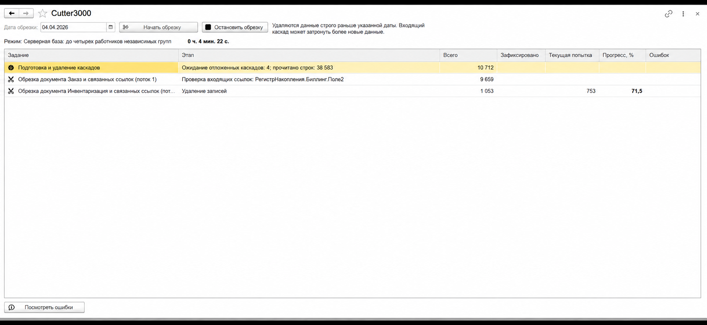
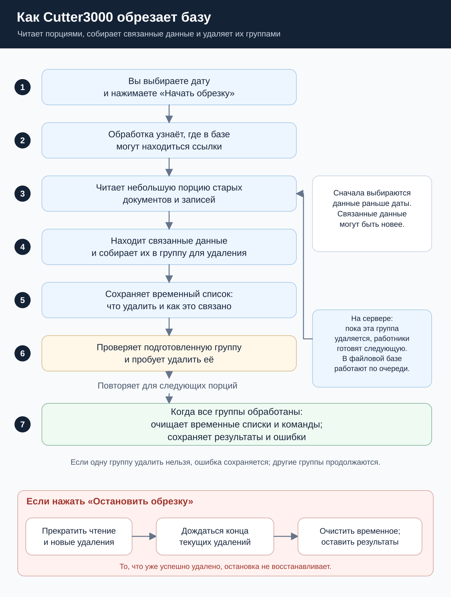

<p align="center">
  
</p>

# Cutter3000

**Создание тестовых баз 1С из рабочих копий: порционная обрезка данных с каскадным удалением зависимостей.**

[Скачать Cutter3000](https://github.com/SmaginAV/Cutter3000/releases/latest) · [Готовый CFE](https://github.com/SmaginAV/Cutter3000/releases/latest/download/Cutter3000.cfe)

Cutter3000 — самостоятельное расширение конфигурации (`.cfe`). Оно анализирует метаданные подключенной базы, не использует БСП и не заимствует объекты прикладной конфигурации.

Пользователь указывает дату и нажимает **«Начать обрезку»**. Расширение удаляет документы и записи независимых периодических регистров строго раньше этой даты, а также связанные данные. Подготовка следующего каскада на сервере идет одновременно с удалением уже подготовленного.

> Используйте отдельную тестовую копию без других пользователей и заданий, изменяющих данные. Каскад может затронуть более новые документы и элементы справочников. Остановка сохраняет уже зафиксированное удаление.



Четкость изображения улучшена с помощью искусственного интеллекта. [Открыть крупно](docs/images/cutter3000-screenshot.png) · [Исходный скриншот](docs/images/cutter3000.jpg).

## Проверенные среды

| База | Платформа | Результат |
| --- | --- | --- |
| Файловая | **8.3.27** | Протестировано; локальные проверки разработки выполнялись на 8.3.27.2074 |
| Серверная **TopLog WMS** / PostgreSQL | **8.3.26** | Протестировано |

Обрезка TopLog WMS за **18 минут**. Это результат одного запуска ревизии, а не обещание времени для любой базы. [Подробнее о проверках](docs/testing.md).

## Возможности

- Обязательная дата; выбранный день сохраняется целиком. Например, дата `01.04.2026` означает удаление данных до начала 1 апреля.
- Каскадное удаление обычных входящих ссылок, записей регистров и движений удаляемых документов. Движения учитываются независимо от их собственного периода.
- План для очередной порции, без предварительного чтения всей базы и общего индекса всех ее данных.
- Повторное использование карты ссылочных полей и описаний таблиц.
- Серверный пул: два читателя и до двух работников удаления. Свободный работник получает независимый каскад; пересекающиеся порции откладываются и перечитываются после освобождения конфликта.
- Файловая база: последовательное выполнение подготовки и удаления.
- Транзакции удаления, счетчики зафиксированных изменений, текущей попытки и ошибок, этапы работ и общий счетчик времени.
- Таблица ошибок с подробностями по двойному щелчку. Ошибка удаления откатывает соответствующий каскад; остальные независимые каскады продолжаются.
- **«Остановить обрезку»**: прекращение чтения, запрет новых транзакций, ожидание текущих удалений и очистка временных данных.

## Алгоритм

Обработка берет небольшую порцию старых данных, находит связанные с ними записи и составляет список для удаления. Пока одна группа удаляется, на сервере готовится следующая. В файловой базе эти действия идут по очереди.



[Открыть схему крупно](docs/images/algorithm.svg) · [Скачать картинкой](docs/images/algorithm.png) · [Объяснение по шагам](docs/algorithm.md)

### Зачем нужны служебные регистры

Шесть регистров помогают организовать работу. Четыре содержат временные списки и команды; два сохраняют результаты и ошибки.


[Как составляется список для удаления](docs/images/cascade-index.svg) · [Что происходит при удалении](docs/images/deletion-index.svg) · [Объяснение работы регистров](docs/indexes-and-registers.md).

## Установка и запуск

1. Скачайте [Cutter3000.cfe из последнего выпуска](https://github.com/SmaginAV/Cutter3000/releases/latest/download/Cutter3000.cfe).
2. В тестовой копии базы откройте Конфигуратор и управление расширениями. Добавьте CFE с областью действия **«Информационная база»** и проверьте возможность применения.
3. Запустите новый сеанс Предприятия с правами чтения и удаления данных, изменения регистров и использования объектов Cutter3000.
4. Откройте раздел **Cutter3000**, укажите дату и нажмите **«Начать обрезку»**.
5. Следите за этапами, зафиксированным объемом и ошибками. При необходимости нажмите **«Остановить обрезку»** и дождитесь завершения очистки.

[Подробная инструкция установки и работы](docs/installation.md).

## Требования и границы применения

Платформа **8.3.26 или новее**, совместимость основной конфигурации **8.3.14 или новее**. Поддерживаются файловые и серверные базы с управляемыми формами. Разделение данных в текущей реализации не поддерживается.

Алгоритм не содержит имен объектов TopLog WMS или другой прикладной конфигурации. Это не гарантирует успешное удаление при любых прикладных обработчиках и правах: неудаляемые каскады попадают в ошибки.

**Хранилища значений, табличные документы и СКД не читаются и не обходятся.** Внутри них могут остаться битые ссылки. Отдельная проверка входящих ссылок после удаления отключена; сохраняются предпроверка обычных ссылок по карте и проверки сохранности затронутых единиц записи. Ссылки, созданные прикладными обработчиками при удалении, также могут остаться. Расширение сокращает объем данных; оно не обеспечивает анонимизацию и достоверность остатков.

Один неделимый связный каскад или набор записей может быть больше обычной порции. Такой каскад не делится между работниками; ускорение зависит от наличия независимых каскадов и скорости СУБД.

## Состав репозитория

```text
README.md
src/cfe/Cutter3000/         # XML-выгрузка расширения и BSL-модули
docs/installation.md       # подключение, работа и остановка
docs/algorithm.md          # устройство конвейера и ограничения
docs/testing.md            # проверенные среды и приемка
docs/images/               # логотип, скриншоты и схемы работы
docs/diagrams/             # редактируемые исходники схем
docs/releases/             # описание первой публикации
```

Готовый CFE, манифест и SHA256 приложены к выпуску в разделе Releases. Локальный комплект `release-assets/v1.0.0` предназначен для вложений выпуска и отдельно от исходников загружается через сайт.

Поставляемая ревизия: **stop-icons-20261012**, версия метаданных: **1.0.0.0**. Контрольная сумма CFE находится в [SHA256SUMS.txt последнего выпуска](https://github.com/SmaginAV/Cutter3000/releases/latest/download/SHA256SUMS.txt).

Тестовые информационные базы, DT демонстрационной конфигурации и локальные настройки разработки в этот репозиторий не включены.
