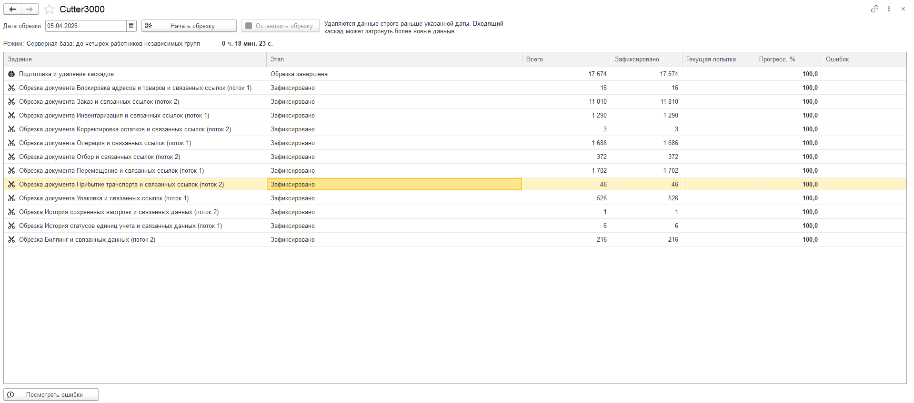
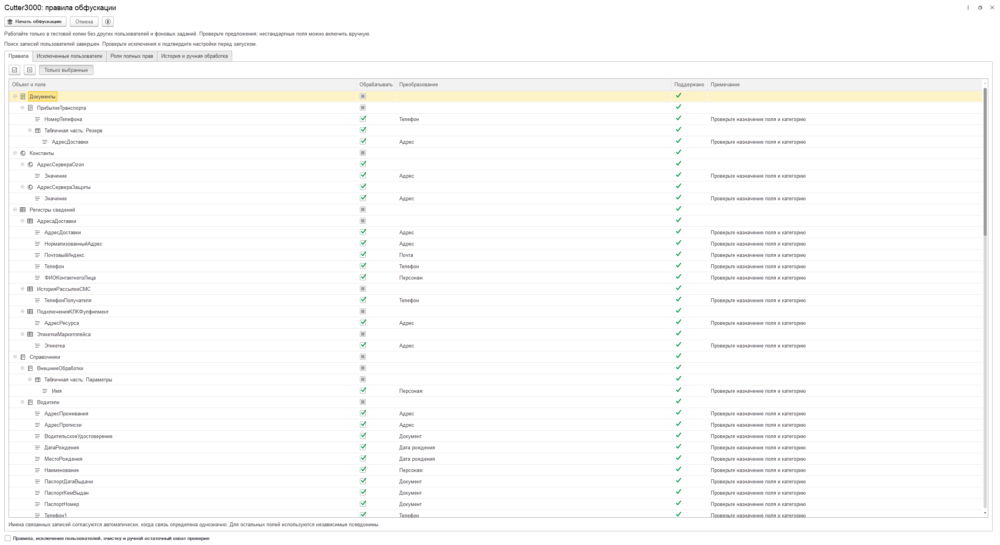

# Cutter3000

**Обрезка и обфускация тестовых копий 1С. Версия 1.1.0.38.**

Сделал Cutter3000, чтобы готовить тестовые базы: удалять старые документы вместе со связанными данными и заменять персональные значения вымышленными. Это самостоятельное расширение `.cfe`, без БСП и заимствования объектов основной конфигурации.

[Скачать расширение](https://github.com/SmaginAV/Cutter3000/releases/download/v1.2.0.00/Cutter3000.cfe) · [Описание выпуска](https://github.com/SmaginAV/Cutter3000/releases/tag/v1.2.0.00) · [Установка](docs/installation.md)

**Результат завершённой обрезки**

**Настройка правил обфускации**

## Что изменилось в 1.2.0.00

Сократил повторную подготовку отложенных каскадов, добавил выдачу независимых компонент свободным работникам и восстановление параллельности после конфликта. План хранится компактнее, подготовленные узлы используются без повторной полной копии, загрузка связей и чтение работниками выполняют меньше мелких операций. Алгоритм выбирает отборы по метаданным и сохраняет работу на разных конфигурациях.

[Изменения относительно предыдущей публикации](https://github.com/SmaginAV/Cutter3000/releases/tag/v1.2.0.00) · [Проверки и локальные замеры](docs/testing.md).

## Что умеет

- Обрезает документы и записи независимых периодических регистров строго раньше выбранной даты; связанные данные удаляет согласованными каскадами.
- На сервере готовит следующие каскады одновременно с удалением готовых. Проверяет пересечения, ограничивает память и число работников.
- Показывает этапы, зафиксированный объём, текущую попытку, ошибки и время. Прогресс хранит последними снимками, без накопления истории сообщений.
- Останавливает чтение и выдачу новых работ, дожидается текущих транзакций удаления и очищает временные данные.
- Обфусцирует выбранные персональные поля по проверяемым правилам. Использует большой словарь персонажей фильмов, сериалов, книг и мультфильмов; имена пользователей делает уникальными.
- Создаёт названия организаций с обозначениями ООО, ЗАО, ОАО и другими формами. В словаре более 4 000 вариантов.
- Сохраняет защищённые учётные записи, выбранные исключения и группы справочников. Предлагает отдельную очистку журнала, истории и настроек.
- Показывает итог обфускации в отдельном окне и открывает справку для выбранной вкладки.

## Где проверил

| Среда | Результат |
|---|---|
| Файловая база, платформа 8.3.27 | Обрезка, обфускация, остановка и повторный запуск |
| Серверная TopLog WMS, платформа 8.3.26, PostgreSQL | Обрезка, остановка и повторный запуск  |
| Серверная база «ТОиР автотранспорта» от Деснол | Обрезка, остановка и повторный запуск  |

Время зависит от состава данных, связей и производительности сервера.

## Как пользоваться

1. Сделайте отдельную тестовую копию базы и установите расширение.
2. Для обрезки укажите первый сохраняемый день и нажмите **«Начать обрезку»**.
3. Для замены персональных значений нажмите **«Начать обфускацию»**, проверьте правила и исключения, затем подтвердите запуск.
4. Следите за таблицей работ и итогом. Ошибки открываются отдельной командой.

Обрезка и обфускация одновременно не запускаются. Кнопка остановки доступна во время активной операции.

## Что учитывать

Работайте с отдельной тестовой копией: изменения удаляют или заменяют данные. Каскад старого документа может затронуть связанные записи позднее выбранной даты.

Обычный режим повторно проверяет входящие ссылки перед удалением. Ускоренный режим пропускает эту проверку обычных ссылок и требует подтверждения риска. Содержимое вложений, хранилищ значений и табличных документов автоматически не обходится. В обфускации такие источники остаются для ручной обработки и отражаются в результате.

Нужны управляемые формы, платформа от **8.3.26**, совместимость основной конфигурации от **8.3.14**. Разделение данных не поддерживается. Прикладные обработчики и права конфигурации продолжают действовать.

## Документация

- [Установка, обрезка и остановка](docs/installation.md)
- [Настройка обфускации](docs/obfuscation.md)
- [Обычный и ускоренный режимы](docs/truncation-modes.md)
- [Алгоритм и служебные регистры](docs/algorithm.md)
- [Проверки и результаты](docs/testing.md)
- [Источники словаря организаций](docs/evidence/organization-dictionary-sources-20261016.md)

Исходники расширения находятся в `src/cfe/Cutter3000`. Готовый CFE, манифест и контрольная сумма приложены к выпуску в разделе Releases. Тестовые базы и локальные настройки в публикацию не входят.
