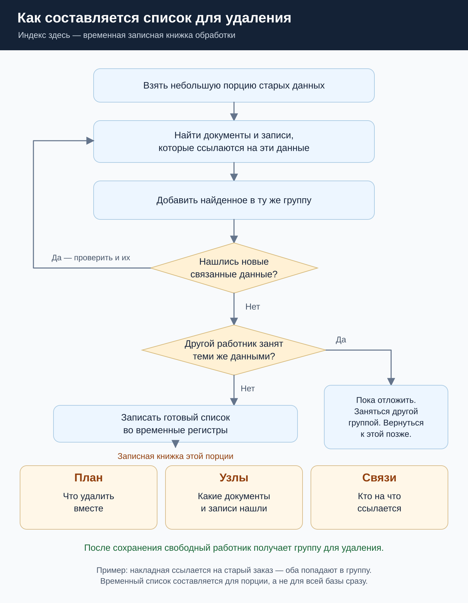
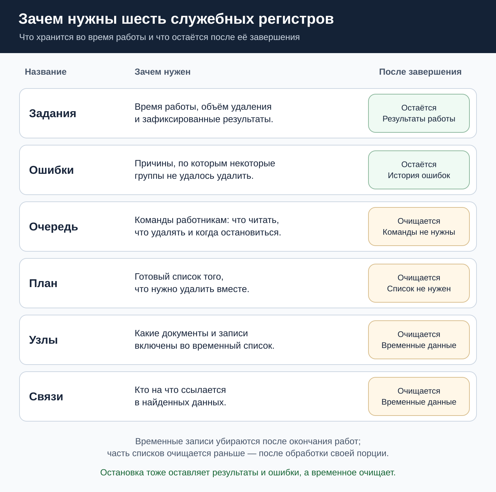
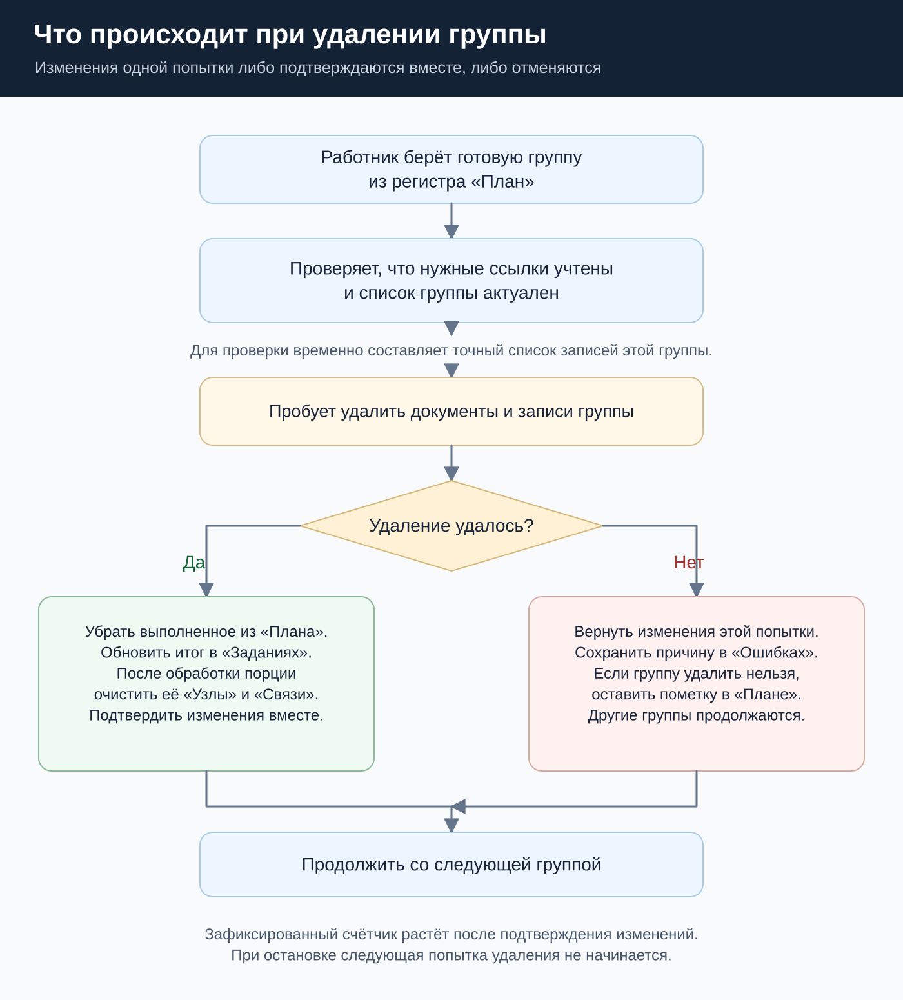

# Служебные списки и регистры простыми словами

## Как составляется список для удаления

[Открыть крупно](images/cascade-index.svg) · [Скачать картинкой](images/cascade-index.png).

Временный индекс можно представить как записную книжку обработки. В ней записано, какие документы и записи найдены и кто на что ссылается. Это не полная копия базы.

Сначала обработка берет старые данные и ищет тех, кто на них ссылается. Найденное добавляет в список. Затем ищет связи уже для добавленных данных. Поиск повторяется, пока новых связанных данных нет.

До передачи работнику список находится в памяти. Если он пересекается с уже выполняемой работой, обработка оставляет только начальные данные порции и временно откладывает ее. Отложенные порции находятся в памяти, а регистр «Очередь» используется для команд работникам.

Когда группа готова и ее можно передать на удаление, обработка сохраняет ее в трех регистрах: «План», «Узлы» и «Связи». Вместе с ними обновляет объем работы в «Заданиях». Только после успешного сохранения сообщает работнику через «Очередь», что группу можно удалять.

## Для чего нужны все шесть регистров

[Открыть крупно](images/registers.svg) · [Скачать картинкой](images/registers.png).

| Регистр | Что делает | Когда используется | Что остается после окончания |
| --- | --- | --- | --- |
| Задания | Запоминает время, объем и результаты работы | От запуска до окончательного результата; форма читает эти сведения | Результаты сохраняются |
| Ошибки | Запоминает причину, время и подробности проблемы | Если удаление или обслуживание не получилось; форма показывает сохраненные ошибки | Ошибки сохраняются |
| Очередь | Передает работникам команды и получает ответы; хранит просьбу об остановке | Во время чтения, удаления и остановки | Очищается |
| План | Хранит готовый список того, что нужно удалить вместе | При передаче группы, при удалении и при пропуске неудаляемой группы | Выполненное убирается сразу; остаток очищается в конце |
| Узлы | Хранит, какие документы и записи входят во временные списки | При подготовке, проверке пересечений и удалении | Временные записи очищаются |
| Связи | Хранит, кто на что ссылается в найденных данных | При подготовке и проверке группы перед удалением | Очищается вместе с соответствующими узлами |

«Узлы» и «Связи» подготовленной порции очищаются после окончания работы над ней. Если часть групп порции еще не обработана, эти списки пока нужны. После окончания всего запуска или остановки очищается весь его временный остаток.

В редком случае поле типа «Момент времени» содержит ссылку внутри значения. Чтобы не читать такую таблицу заново для каждого поиска, обработка может сохранить дополнительный временный список в «Узлах» и «Связях». После изменения данных такой список удаляется и при необходимости строится заново. Это не обход прикладных хранилищ значений.

## Что происходит при удалении

[Открыть крупно](images/deletion-index.svg) · [Скачать картинкой](images/deletion-index.png).

Работник берет группу из «Плана». Перед удалением проверяет, что нужные ссылки учтены. Для проверки создает точный временный список записей группы: так можно отличить уже включенные записи от владельцев ссылок, которые в группу не попали.

При успешном удалении выполненная группа убирается из «Плана», результаты в «Заданиях» увеличиваются. Если в этой порции больше нет ожидающих групп, ее «Узлы» и «Связи» очищаются. Удаление данных, изменение служебных списков и счетчиков подтверждаются вместе.

При ошибке изменения этой попытки отменяются вместе. Если пакет содержал несколько групп, обработка может попробовать их отдельно. Группа, которую удалить невозможно, остается в базе; в «Плане» сохраняется пометка, а в «Ошибках» — причина. Пометка защищает последующие группы от удаления зависимостей оставшихся данных.

При остановке новые попытки не начинаются. После окончания текущих работ очищаются «План», «Узлы», «Связи» и «Очередь». «Задания» и «Ошибки» остаются.

[Как работает обработка](algorithm.md) · [Вернуться к главной странице](../README.md).
